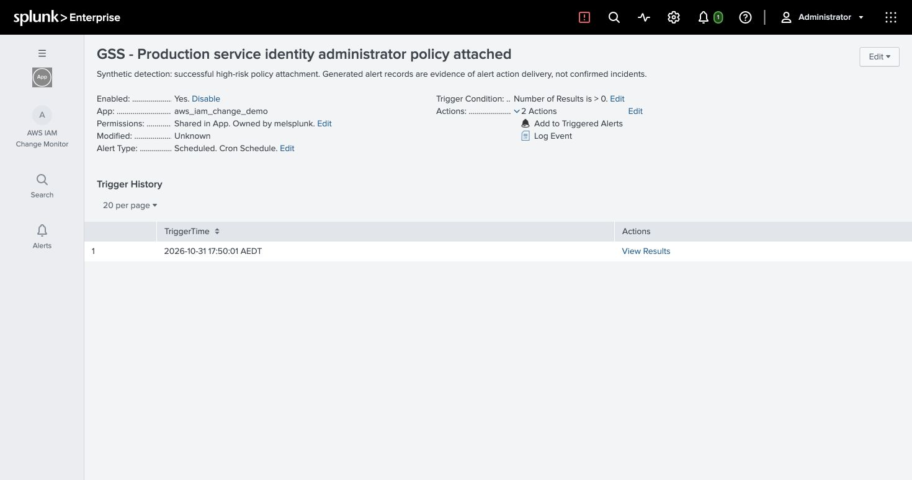

# AWS IAM Change Monitor with Splunk

[](https://github.com/MelZhang06/aws-iam-change-monitor/actions/workflows/validate.yml)

A synthetic, reproducible Splunk Platform demo for portfolio and teaching use.

This personal project demonstrates how to **detect a high-risk IAM change, record an alert, and verify the evidence and approval scope**.

The investigation begins when an enabled scheduled rule finds a successful `AdministratorAccess` attachment to a production service identity, or a target with missing context. A later key creation provides investigation context; failed logins and MFA assumptions are not prerequisites.

**Verified locally on 31 October 2026:** Splunk Enterprise 10.6.1.1, 50,000 initial unique events, 20 fictional accounts, natural scheduled alert delivery, four recorded findings, row-to-evidence drilldowns and action-specific approval checks. **55 local tests pass.** The linked GitHub Actions workflow checks Python 3.10 and 3.12; its badge shows the latest remote result. No AWS account or Splunk Enterprise Security is required.



## Start here

1. Read the [scenario and operating guide](docs/change_monitor_v2.md).
2. Generate data, build the isolated app and run local checks:

   ```sh
   python3 scripts/change_scenario.py prepare --count 50000
   python3 scripts/build_change_app.py
   python3 -m unittest discover -s tests
   ```

3. Install on your own local Splunk Enterprise instance, replacing the owner with an existing local Splunk username:

   ```sh
   python3 scripts/install_change_app.py --splunk-home /Applications/Splunk --owner YOUR_LOCAL_SPLUNK_USERNAME --restart
   ```

   This writes only the named demo app and restarts the local service. Use the appropriate Splunk path on another machine. It is not a Splunk Cloud installer. Existing managed installations require explicit `--update`. Authenticate in Splunk Web yourself; no passwords or tokens are stored by this project.

4. Open **AWS IAM Change Monitor** and follow the [presenter walkthrough](docs/change_monitor_presenter.md). Replay `normal`, then `policy`; verify automatic delivery before replaying `followup`.
5. Review the [actual validation and root-cause walkthrough](docs/change_monitor_completion.md), including the negative and late-arrival tests.

The [portable Dashboard Studio JSON](dashboards/aws_iam_change_monitor.json), [readable SPL](spl/change_monitor), and [generated Splunk app](splunk_app/aws_iam_change_demo) are included. Data and append-only replay state stay local under the gitignored `data/iam_change/` directory. The builder requires generated context; it refreshes the app lookup CSVs. Large JSONL fixtures are regenerated rather than committed.

## The business story

A legacy reporting service retains an IAM user's long-term access key as an explicit exception. Its expected permissions are read-only. A maintenance role uses temporary credentials to perform key lifecycle work, but its delegated policy-attachment authority is insufficiently restricted.

The fictional approved change allows key lifecycle actions; it does **not** authorise an AdministratorAccess attachment. Detection raises the concern immediately. The analyst then checks target ownership, role session, API outcome, original event IDs and the exact change scope. A matching key action cannot approve the separate policy change.

The demonstrated conclusion is **a high-risk permission change requiring verification**. It does not establish credential theft, effective unrestricted administrator privileges, key use or data exfiltration. A role session is not a verified employee identity. Boundaries and SCPs require separate evaluation.

## What is implemented

- Seven days of generated read-only management activity across 20 fictional accounts, with stable role sessions and fabricated credential identifiers.
- Append-only scenario replay with API error controls, duplicate delivery, two-hour late arrival, unknown assets and a permissions-boundary case.
- Every-minute scheduled detection using a 15-minute ingestion-time lookback and an all-time event window.
- Native **Triggered Alerts** plus a built-in **Log Event** action into a separate alert index. No email or external notification channel.
- A dashboard queue based on delivered alert records; selected account, target and original event window scope the evidence.
- Fictional asset/configuration/change registers with temporal validity and exact action-level approval matching.
- A small fixture state model that enforces the two-key quota and supports simulated cleanup between presentations.

This is a single-instance teaching/demo design. It does not claim production throughput, exactly-once delivery, an IAM policy simulator or a complete SOC case-management workflow. See the operating guide for backfill, suppression and time-window limits. Charts show a rolling eight-day window; that count naturally differs from the all-time fixture total as the data ages.

## Repository map

| Location | Purpose |
| --- | --- |
| `scripts/change_scenario.py` | Deterministic history, fictional context, replay and fixture state |
| `scripts/build_change_app.py` | App configuration, detection SPL and dashboard generation |
| `scripts/install_change_app.py` | Explicit local install/update; optional restart |
| `spl/change_monitor/` | Detection and evidence searches for review |
| `splunk_app/aws_iam_change_demo/` | Portable app defaults and fictional lookup CSVs |
| `tests/` | Scenario, correlation and existing demo regression checks |
| `docs/examples/change_monitor/` | Saved local validation evidence and verified dashboard export |
| `docs/screenshots/` | Actual local Splunk screenshots |

The existing [88-event teaching fixture](docs/validation.md) and [earlier IAM-user enterprise simulation](docs/enterprise_simulation.md) remain available as historical learning material. Their sign-in sequence and previous verification results are **not** the detection contract of the current app. The [design review](docs/scenario_redesign_review.md) explains the redesign.

## Sources, data and licensing

AWS and Splunk documentation links supporting the scenario and detection mechanics are collected in the [operating guide](docs/change_monitor_v2.md#references). The fixtures and scenario are original synthetic material. No customer logs, usable credentials, third-party dashboard source or Enterprise Security content is bundled.

No open-source license has been selected by the project owner. Do not assume MIT or another reuse grant; choose a license before publishing if you want to grant reuse rights. Splunk software and third-party documentation retain their own terms.
