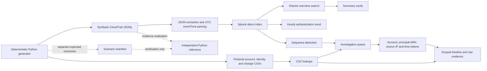

# Architecture and data provenance

The manifest is never ingested and is not a detection lookup. Detection uses event evidence; ownership and approval context come from explicitly fictional CSVs. The original 88-event teaching fixture and the 50,000-event enterprise fixture use separate indexes. No AWS account is contacted by this pipeline.

## Processing choices

- JSON fields are extracted once by the custom source type. Searches do not add redundant `spath`.
- `_time` comes from UTC `eventTime`; the viewer's profile controls display timezone.
- `eventID` deduplication prevents repeated copies from inflating findings; the ingestion gate still checks raw record counts separately.
- The queue groups by account, principal ARN, source, qualifying sign-in and affected user. It is a list of candidate sequences, not one row per log or one permanent verdict per employee.
- Approval enrichment occurs after reducing the stream to qualifying IAM changes. Multiple records with the same action key are checked against UTC validity intervals, then reduced back to distinct event IDs.
- Detail searches inherit the global range and intersect it with the selected candidate window. The overview and candidate count use chained transforming results to avoid unnecessary repeated scans.

## Future live ingestion path — not implemented

An organisation could evaluate CloudTrail → S3 → SQS → a compatible Splunk Add-on for AWS input, with permissions, coverage, retention, cost and data handling designed for its environment. This repository neither provisions that path nor verifies an add-on version. Role sessions, Identity Center and data events require their own schema and investigation design.

See [setup_enterprise.md](setup_enterprise.md) for the implemented local path and [validation.md](validation.md) for what has actually been tested.
