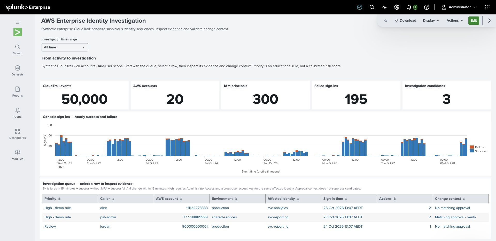

# From AWS Activity Logs to Actionable Security Insights

A reproducible, synthetic AWS CloudTrail investigation demo for portfolio and teaching use. Use Splunk Platform and SPL1 to move from suspicious sign-ins to sensitive IAM changes, then explain the evidence and investigation limits.

**Working demo:** the enterprise Dashboard Studio dashboard, sequence searches, CSV context and all three investigation drilldowns were verified in **Splunk Enterprise 10.6.1.1** on 28 October 2026. The saved Studio definition matches the portable JSON in this project. **36 local tests pass.** Enterprise Security and an AWS account are not required. GitHub Actions has not been run remotely; publication and a narrated recording remain with the project owner.



## Start here

1. Follow the [enterprise setup guide](../setup_enterprise.md) to generate the fixture, configure JSON parsing, install the three fictional lookups and import the [Dashboard Studio definition](../../dashboards/aws_enterprise_identity_investigation.json).
2. Use the [15-minute presenter walkthrough](../presenter_walkthrough.md) for the demonstration flow: overview → candidate queue → scoped evidence → ownership and change context.
3. Review the [sample investigation](../sample_investigation.md) and [work log with root causes and verification](../completion_walkthrough.md).

The [architecture diagram](../architecture.md) shows the implemented pipeline and separates the future AWS ingestion path.

The enterprise view reduces the fixture to **three investigation candidates with five qualifying IAM actions**. Alex's two changes have no matching approval. Pat-admin's similar pattern matches a narrowly scoped fictional change record and remains in the queue for verification. Jordan's key-only pattern is Review. These are educational rules, not calibrated risk scores or confirmed compromises.

## Larger simulation

A separate enterprise-style **IAM-user** simulation is verified locally and in Splunk: **50,000 events, 20 fictional accounts, 300 caller principals, seven days**. It includes normal activity and six known scenario/control cases. See [the simulation guide](../enterprise_simulation.md) for the dataset contract and [the setup guide](../setup_enterprise.md) for reproducibility. Keep its index separate from the original 88-event teaching demo described below.

## Original teaching investigation

Across three fictional AWS accounts, find this sequence:

1. Six failed console sign-ins associated with `alex` from `203.0.113.77`.
2. A successful sign-in without MFA seven minutes after the first failure.
3. Alex attaching `AdministratorAccess` to **`svc-analytics`**, at minute thirteen.
4. Alex creating an access key for **`svc-analytics`**, at minute fourteen.

Compare it with an isolated five-failure burst and fictional approved administration. The dataset has **88 events**: 66 console logins, 18 `ListUsers` calls, two policy attachments, and two access-key creation events. Credential material is omitted. All events, identities, account numbers, and ownership context are fictional.

## Generate and verify the teaching fixture locally

Python 3.10+; no external packages needed for the synthetic demo. Run from the repository root:

```sh
python3 -m unittest discover -s tests -v
python3 scripts/generate_events.py --anchor 2026-10-25T12:00:00Z --force
python3 scripts/check_data.py data/synthetic_cloudtrail.jsonl --manifest data/synthetic_cloudtrail.manifest.json
python3 scripts/expected_results.py data/synthetic_cloudtrail.jsonl
```

`--force` replaces the generated synthetic JSONL and its manifest. Omit it to protect existing output. The same seed and anchor produce identical files. The manifest describes the scenario and stays separate from ingested events.

For a presentation using **Last 24 hours**, generate current timestamps instead:

```sh
python3 scripts/generate_events.py --force
```

For the fixed anchor above, events run from **25 October 2026, 02:00–10:50 UTC**. Use an absolute search window of 25 October 2026 00:00 UTC through 26 October 2026 00:00 UTC. Splunk may display time in your profile timezone; compare UTC `eventTime` with `_time` carefully.

## Verify the teaching fixture in Splunk

1. Use a user-controlled Splunk Enterprise or Cloud instance where you can upload synthetic data. Create `aws_security_demo` if your permissions permit; otherwise change the index name in `scripts/build_searches.py` and rebuild the SPL files.
2. Upload `data/synthetic_cloudtrail.jsonl` through **Settings → Add Data → Upload**. Configure one JSON object per event, sourcetype `aws:cloudtrail:demo`, and UTC timestamps from `eventTime`. Inspect the parsing preview before completing ingestion. Do not upload the manifest.
3. Set a time range covering the generated events. Confirm the ingestion and expected results using [the validation guide](../validation.md).
4. Run searches `01` through `06` individually. Add the optional fictional lookup before running `07`; use `08` to inspect raw evidence. The searches use fields supplied by the JSON source type and require no custom macros. Avoid a redundant `| spath` when JSON fields are already extracted; it can duplicate field values.
5. Record actual results and version details. Only then proceed to Dashboard Studio and drilldowns.

If you use another sourcetype, update `PREFIX` in `scripts/build_searches.py` and run `python3 scripts/build_searches.py`. The demo source type should inherit JSON indexed extraction with `KV_MODE=none`, `SHOULD_LINEMERGE=false`, `TIMESTAMP_FIELDS=eventTime`, `TIME_FORMAT=%Y-%m-%dT%H:%M:%SZ`, and `TZ=UTC`. The custom name avoids assuming that an AWS add-on is installed, but JSON field and timestamp extraction still need validation.

Re-uploading the same fixed fixture creates duplicate indexed records. Searches deduplicate by `eventID`, but raw ingest counts and storage still increase. A new anchor creates new IDs and represents a new run. Select the exact run's time range or use a separate demo index when permitted. Do not delete shared index data to reset the demo.

## Project contents

- `scripts/generate_events.py`: deterministic generator, fixed or current UTC anchor.
- `scripts/check_data.py`: read-only synthetic JSONL/schema/credential-field checks.
- `scripts/expected_results.py`: independent Python reference findings; **not an SPL interpreter**.
- `scripts/build_searches.py` and `spl/`: raw-JSON extraction plus nine investigation searches.
- `scripts/build_enterprise_dashboard.py`: portable Studio JSON, seven enterprise searches and fictional lookup copies, derived from the generated fixture.
- `dashboards/`, `spl/enterprise/`, `lookups/enterprise_*.csv`: the verified enterprise experience.
- `docs/screenshots/`, `docs/examples/`: actual screenshots, live visible-result extracts, saved Studio export and expected findings.
- `lookups/demo_identity_context.csv`: optional fictional ownership and approved-change context.
- `tests/`: scenario, CLI, malformed-input, and investigation edge-case checks.
- `.github/workflows/validate.yml`: intended local-validation CI on Python 3.10/3.12; not yet run on GitHub.
- [Research and delivery plan](../research_and_demo_plan.md): official sources, scope, and 15-minute presentation structure.
- [Validation guide](../validation.md): expected results, live checks, and current verification status.
- [Discovery questions](../discovery_questions.md): customer conversation and demonstration flow.

## Interpretation and limits

A suspicious sequence is not proof of compromise. `MFAUsed=No` means MFA was not used for this sign-in; it does not prove an MFA device was disabled. The caller and affected user are distinct. A policy attachment alone does not establish effective access under every applicable policy control.

The fixed failure rule uses at least five events in a fixed 15-minute bucket, aggregated by account and source IP. It can combine different observed usernames behind one IP and is an educational threshold. It is not a password-spraying verdict or a sliding-window detector. The separate sequence search evaluates a rolling interval and requires an observed IAM principal ARN. Missing or masked identity weakens attribution; source IP alone does not establish common identity or session.

Documentation IPs must not be geolocated. The demo does not implement role-session/Identity Center attribution, Enterprise Security correlation/risk workflows, threat intelligence, SOAR, or production SIEM coverage. See the cited research for the differences between original Splunk content and these educational adaptations.

## Optional real AWS data

`scripts/export_event_history.py` is an optional read-only, regional exporter requiring `boto3`, a named AWS profile, and authorized CloudTrail lookup permissions. It has not been executed or validated in AWS. Keep its output private; do not run the synthetic checker against real logs or publish real-account telemetry. The default output is ignored by git. Never add credentials to source or prompts.

Do not perform real IAM grants, create real access keys, disable MFA, or stop logging to reproduce the scenario. A future live ingestion path can use CloudTrail → S3 → SQS → Splunk Add-on for AWS, subject to actual version, permission, and cost requirements. No cloud resources are provisioned by the synthetic demo.

## Portfolio publication

The reproducible demo, saved dashboard source, live screenshots, presenter script and sample investigation are included. Generated JSONL and manifests remain ignored by git; readers generate them locally. Only fictional lookup context and synthetic screenshot evidence are intended for publication. Workshop PDFs, real AWS logs and credentials are not bundled.

Before publishing, choose a license for your original work and optionally record your own narrated walkthrough. No license is granted by implication from the presence of public documentation references. No upstream detection pack or workshop dataset is redistributed. Production-scale performance, live AWS ingestion, role/Identity Center attribution and exhaustive live SPL boundary validation remain outside this release.
