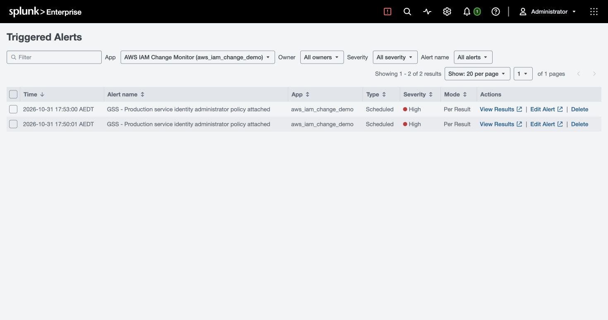
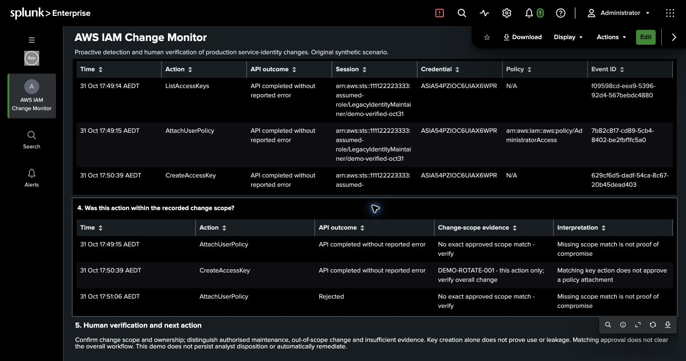

# Completion Record — Proactive Detection and Human Verification

Validation date: 31 October 2026, Australia/Melbourne. Actual environment: local Splunk Enterprise 10.6.1.1 and Python 3.12.15. The results below come from real local ingestion, natural scheduled execution, and UI interaction. The AWS events themselves are entirely original synthetic data.

## 1. Business redesign

An ongoing rule initiates review when AdministratorAccess is successfully attached to a production service identity, or when the same high-risk attachment targets an identity whose asset context is missing. Failed sign-ins, absent MFA, and key creation are no longer necessary discovery conditions.

The target is an IAM user for a legacy reporting system. Its long-term key is an explicit exception in the scenario, not a recommended architecture for new systems. The maintainer uses a temporary LegacyIdentityMaintainer role session. Its technical permissions allow the API calls, while the business change approves only key lifecycle work, not the administrator policy attachment.

The analyst follows the alert through account and target, API completion/rejection, original events and role sessions, exact action-level approval scope, and unresolved evidence or response requirements. An approved key action does not automatically approve a policy change in the same workflow.

## 2. Implementation and isolation

The isolated `aws_iam_change_demo` app preserves the earlier teaching projects. New events enter the `aws_iam_change_demo` index; the built-in Log Event action writes into `aws_iam_change_alerts`. The app runs as an existing local user. It adds no accounts, changes no authentication settings, and has no real AWS connection.

File monitoring ingests 50,000 read-only background events over seven days across 20 fictional accounts, plus a stream appended in phases. The generator includes no malicious label to help detection and no secretAccessKey or sessionToken. Temporary credential IDs support session association, not attribution to a verified person.

The rule runs every minute, searching the preceding 15 minutes of ingestion with an All time event window so that newly arriving older events are not excluded. Finding IDs use the account, original event ID, and rule version. Actions fire per result, with 24-hour suppression of repeat delivery for the same finding.

The dashboard queue reads persisted alert-action records rather than recomputing raw detection results and labeling them delivered alerts. Row selection passes the account, target, and original event's 15-minute-before/after window to the investigation. Different callers remain visible; a shared IP or target does not establish the same person.

## 3. Actual acceptance results

All clock times below are AEDT unless explicitly marked UTC.

| Check | Observed result | Outcome |
| --- | --- | --- |
| Initial ingestion | 50,000 records, 50,000 distinct event IDs, 20 accounts | Passed |
| UTC timestamps | Every eventTime parsed; maximum difference from `_time` was 0 seconds | Passed |
| Normal rotation | One Create/Update/Delete call each; natural 17:49 run had result_count=0 | This high-risk policy rule did not match |
| Policy phase | Only ListAccessKeys and AttachUserPolicy; no key creation yet | Detection did not require a later key |
| Automatic alert | 17:50 run: success, result_count=1, fired=1, logevent | Passed |
| Native record | Trigger History showed 17:50:01 AEDT | Passed |
| Action delivery | One alert-index record and one dashboard finding | Passed |
| Alert drilldown | Correct account, target, role/temporary credential, and original event ID | Passed |
| Follow-up phase | Key creation shared the attachment's temporary credential; key matched DEMO-ROTATE-001, policy had no exact scope match | Passed |
| Duplicate and rejected input | 50,009 raw records, 50,007 unique events, one rejection; still one delivered alert | Passed |
| Overlapping schedule suppression | 17:52: result_count=1, suppressed=1, fired=0 | Passed |
| Late, unknown, and bounded cases | 17:53: result_count=4, suppressed=1, fired=3; four findings in the alert index | Passed |
| Late-event drilldown | Alert received at 17:53; original event UTC 04:52:13; evidence showed the single older event at local 15:52 | Ingestion and event time remained distinct |
| Unregistered target | svc-unregistered showed Unknown / Missing or out-of-period snapshot, with original evidence | Not silently dropped |
| Bounded target | svc-bounded showed ReportReadBoundary and the attachment fact | No claim of unrestricted effective administrator privileges |
| Synthetic cleanup | Appended key deactivation/deletion and policy detachment; retained all history | Simulated state only |
| Final ingestion | 50,015 raw records, 50,013 unique events, 20 accounts, one rejection, four alert actions/findings; every timestamp difference 0 | Passed |
| Saved Studio definition | JSON in the actual local XML equaled the portable JSON object | Passed |
| Local regression | 55 unittest checks passed | Passed |

Native **Triggered Alerts showed two rows** for the triggering runs at 17:50 and 17:53. The second run executed per-result actions for three new findings. Two native execution records and four indexed findings count different objects. Verify action delivery with raw alert records and finding IDs, rather than treating UI row count as finding count.

The validation run ID was `verified-oct31`. That sample now includes negative controls and synthetic cleanup. Use a new run ID for a presentation and wait for each phase's checks. Do not delete index history to make the view look cleaner. Saved evidence and scheduler logs are in the [validation artifacts](examples/change_monitor/).

## 4. Problems, root causes, and resolutions

| Problem | Root cause | Resolution and verification |
| --- | --- | --- |
| The earlier story needed an artificial explanation for MFA failure | Several related signals were forced into a mandatory attack chain without an independent investigation trigger | Trigger on a verifiable successful high-risk permission change; verify the policy alert before emitting follow-up context |
| Asset and change context expired between preparation and presentation | Fictional context had bounded validity windows, and the dates differed | Added refresh-context to archive old CSVs and renew the fictional window without changing historical events; rechecked approval results in the UI |
| Timestamp verification initially differed by 39,600 seconds | The checking query treated Z as a literal and strptime used local time; index timestamps were not wrong | Replaced Z with +0000 and parsed %z explicitly; final maximum difference across 50,015 records was 0 |
| Configuration serialization failed | Newlines, backslashes, and search continuation needed Splunk conf syntax | Fixed the line breaker and single-line saved search; btool checks preceded installation, followed by actual ingestion/scheduling checks |
| Detail data sources had the wrong type | A positional builder argument interpreted query parameters as a chained-source reference | Used named params arguments; validated references/types in tests and all four detail panels through actual clicks |
| CLI searches required authentication | No CLI login cache existed; a Web session did not authenticate the CLI | Did not read passwords or authentication files; used the signed-in Splunk Web session for queries and verification |
| Updated files still displayed the old table | Splunk cached the view; a browser refresh did not reload the server-side definition | Applied and saved the same JSON through Studio Source code, then compared the actual local definition with the project JSON |
| Asset context was hard to read | Eleven columns repeated account/target information and long ARNs | Combined service/platform owners and reduced the summary to six columns; account/target remain in the heading and role/original evidence in their panels |
| Repeated demonstrations could imply an impossible third key | Without cross-run state, each replay assumed only the initial key existed | Added a fixture ledger enforcing the two-key quota and lifecycle, with synthetic cleanup; tested quota enforcement and cleanup across runs |
| Cleanup events initially shared one second | Second-level timestamps could not establish exact ordering from event ID sorting | Future generation separates steps by a second; retained the indexed validation history and did not use its same-second events as proof of precise causal ordering |

The eight-day background chart may contain a low/empty interval between the historical fixture and live replay. The history ended on 28 October at 13:01:19 UTC; replay occurred on 31 October. This is an actual gap in the synthetic input, not timechart padding after the last event. `fixedrange=false` cannot remove an interval between genuine first and last events. A fresh workspace can prepare new history anchored to the current time; hiding the gap would not establish continuous collection.

## 5. Local use and repeat presentations

Open [AWS IAM Change Monitor](http://localhost:8000/en-GB/app/aws_iam_change_demo/change_investigation). For native records, select Activity → Triggered Alerts. For the rule, select the app's Alerts entry and then GSS - Production service identity administrator policy attached.

See the [operating guide](change_monitor_v2.md) for generation, installation, and replay commands, and the [10-minute presenter walkthrough](change_monitor_presenter.md) for narration. Saved Studio edits live in the app's local view and override its default view. After changing the builder and updating the app, apply the new JSON in Studio or explicitly manage your local override. The installer does not delete existing local edits.

Local Splunk monitors the append-only replay stream. Do not run replay commands in parallel, overwrite existing history, or clear the ledger while reusing the same index. Use a new run ID when the simulated session expires. Native records and the dashboard list have 24-hour display windows; they are not permanent case state.

## 6. Presenting the conclusion

> Scheduled detection found an administrator policy successfully attached to a production service identity. The supplied rotation approval matched key lifecycle actions, not the policy attachment. I would ask the responsible teams to verify other approvals and explain the change, then follow the authorized response process for permissions and credentials and investigate related usage and data-access evidence.

The evidence supports a high-risk change and a difference from the supplied approval scope. It does not confirm account theft, key use, or data exfiltration. Boundaries/SCPs, other policies, and real business approvals require additional evidence. API completed means no API error was observed; it is not a full effective-permission evaluation or business approval.

No email/Slack/ITSM integration, real AWS ingestion, automatic IAM remediation, or persistent analyst disposition was configured. Synthetic cleanup resets the fixture ledger; it is not proof of successful real-world containment. The local validation above preceded publication. The project is now [published on GitHub](https://github.com/MelZhang06/aws-iam-change-monitor), with [remote CI results](https://github.com/MelZhang06/aws-iam-change-monitor/actions). The owner has not selected an open-source license.

## 7. Reviewable screenshots

