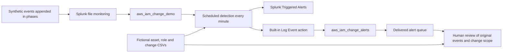

# AWS IAM Change Monitor — Scenario and Operating Guide

The current version detects a successful high-risk policy attachment directly. It replaces the earlier requirement for a sequence of failed sign-ins, a successful sign-in without MFA, and an IAM change. The earlier version remains as historical teaching material; its validation results do not establish that the current alert workflow works.

## Operating architecture



The input is a synthetic log replay, not a live AWS CloudTrail connection. The demo performs no real AWS operations, sends no email or Slack messages, and has no ServiceNow or automated containment integration. An alert record establishes that detection and a local alert action ran; it does not establish a compromise. Analyst dispositions are not persisted in the app.

## Scenario and evidence

The target is a legacy reporting service's IAM user that retains long-term credentials. Its expected permission baseline is read-only reporting access. The caller is a temporary maintenance-role session in the member account. The role already has policy-management authority, but its policy-attachment scope is insufficiently restricted. Business approval comes from a separate change record and is distinct from IAM API authorization.

Change `DEMO-ROTATE-001` allows the role to rotate keys for `svc-report-export`; it does not authorize an AdministratorAccess attachment. The rule should alert as soon as that policy is successfully attached. A later key creation may match the change, but that match cannot approve the separate policy attachment.

Asset and role snapshots are explicitly fictional configuration evidence, not effective-permission results obtained from live IAM queries. `mfaAuthenticated=false` is not used to claim that upstream federated MFA did not occur. Role and temporary-credential identifiers support session correlation; they do not establish a person's identity.

## Project components

| Component | Location |
| --- | --- |
| Events and replay | `scripts/change_scenario.py` |
| App builder | `scripts/build_change_app.py` |
| Isolated Splunk app | `splunk_app/aws_iam_change_demo/` |
| Dashboard | `dashboards/aws_iam_change_monitor.json` |
| Readable SPL | `spl/change_monitor/` |
| Local installer | `scripts/install_change_app.py` |
| Generated data and state, excluded from Git | `data/iam_change/` |

## Generate and install

Python 3.10+ is required. Local validation used Python 3.12.15. Start with:

```sh
python3.12 scripts/change_scenario.py prepare --count 50000
python3.12 scripts/build_change_app.py
python3.12 -m unittest discover -s tests
```

`prepare` creates seven days of read-only management events across 20 fictional accounts and an empty append-only stream. It refuses to overwrite an existing history file. It does not clear indexes or previous replays. Use `--anchor` for a fixed timestamp with a timezone; otherwise, the generator uses current UTC for a fresh demonstration.

Three context CSVs describe assets and validity periods, maintenance roles and delegation scope, and action-specific approval records. No malicious flag or scenario-outcome label is inserted into the events to help the detector.

Before presenting several days later, check whether the fictional context has expired. To establish a new fictional demonstration window, run `python3.12 scripts/change_scenario.py refresh-context`, rebuild the app, and deploy it with the installer's `--update` option. This archives the old CSVs and renews the fictional snapshot and change windows without modifying historical events or replay state. It does not extend a real change approval or retroactively approve old events. The eight-day chart is a rolling window, so its count will not always equal the initial 50,000-event history total. Use a separate `earliest=0` search to check the complete indexed total.

Install on a local Splunk Enterprise instance where you have the required permissions. This writes to the specified installation directory:

```sh
python3.12 scripts/install_change_app.py --splunk-home /Applications/Splunk --owner YOUR_LOCAL_SPLUNK_USERNAME --restart
```

Replace the owner with an existing local Splunk username. The installer creates only the named demo app. Updating an existing directory requires the installer's own marker and explicit `--update`. It installs two demo indexes, inputs, searches, context, and the dashboard; it runs btool checks before an optional restart. `--restart` briefly interrupts the local Splunk service and must be authorized by its operator.

Machine-specific monitoring paths are generated under `data/iam_change/install_overlay/inputs.conf`, rather than embedded in the distributable app defaults. This installer is not a Splunk Cloud deployment method. The app grants read/edit access only to the existing admin role; it does not add users or expand user roles.

## Detection, scheduling, and time

Rule: `GSS - Production service identity administrator policy attached`.

- The management event comes from `iam.amazonaws.com`, the action is `AttachUserPolicy`, the policy ARN exactly matches AdministratorAccess, and no API rejection/error fields are present.
- A time-valid asset record identifies the target as production, or the context is missing/expired. Unknown context is not silently treated as normal.
- Failed sign-ins, absent MFA, key creation, and approval matches are not prerequisites.
- The local demo runs every minute. It searches events **ingested** in the preceding 15 minutes while using an All time event-time window, allowing an older event that has just arrived to be detected.
- Actions fire per result. A finding ID derived from `account + eventID + rule version` is suppressed from repeat triggering for 24 hours.
- Scheduler outages longer than the ingestion lookback, suppression-state changes after rule edits, suppression expiry, and clock anomalies require backfill and operational handling. The demo does not promise production exactly-once delivery.

This is a transparent design for a known, small dataset, not a production throughput recommendation or latency SLA. Real CloudTrail delivery, ingestion, and scheduling each introduce delay. Rule health and source-data health need separate checks; zero alerts do not establish zero risk.

## Phased demonstration and acceptance checks

First verify the initial index: 50,000 background records, 50,000 distinct event IDs, 20 accounts, and correct UTC timestamps. Confirm successful automatic scheduling with zero alerts. Then choose a new run ID, such as `workshop-01`.

### 1. Normal rotation control

```sh
python3.12 scripts/change_scenario.py replay --run-id workshop-01 --phase normal
```

Replay Create/Update/Delete key-management events for a different service identity. This is a compressed synthetic rotation sequence. External application cutover validation is not implemented, so do not claim that the project proves a successful service cutover. This administrator-policy-attachment rule is expected to remain silent.

### 2. Emit the high-risk policy event before any key creation

```sh
python3.12 scripts/change_scenario.py replay --run-id workshop-01 --phase policy
```

This phase contains only a query and a policy attachment. Wait for natural scheduling; do not substitute a manual alert run for the scheduling check. A trigger should appear in Triggered Alerts. The dashboard queue should show the finding only after the built-in Log Event action writes its record into the alert index.

### 3. Investigate the alert and add follow-up context

```sh
python3.12 scripts/change_scenario.py replay --run-id workshop-01 --phase followup
```

Only now is a new key created for the target identity. The investigation timeline should show operations associated with the same temporary credential. Action-level scope checks should match key creation to the rotation approval while leaving the policy attachment unmatched. The existence of a change record does not approve the entire workflow.

The alert queue shows the preceding 24 hours by receipt/detection time. Detail panels use the original selected event's time, with 15 minutes before and after it. The UI labels these two meanings separately, so an event arriving two hours late can still lead from a new alert into the correct historical evidence window. There is no global time input that pretends to control every data source.

### 4. Negative controls, duplicates, and late arrival

```sh
python3.12 scripts/change_scenario.py replay --run-id workshop-01 --phase duplicate
python3.12 scripts/change_scenario.py replay --run-id workshop-01 --phase denied
python3.12 scripts/change_scenario.py replay --run-id workshop-01 --phase late
python3.12 scripts/change_scenario.py replay --run-id workshop-01 --phase unknown
python3.12 scripts/change_scenario.py replay --run-id workshop-01 --phase bounded
```

Expected behavior: repeated original event IDs do not produce new alert actions; rejected policy calls are not treated as successful attachments; a successful call that occurred two hours earlier but was just ingested is detected; an unregistered target still enters review; and a target with a permissions boundary still produces an attachment finding without a claim of unrestricted effective privileges.

Record these results from actual scheduled execution. Local Python checks are not a substitute for that acceptance test.

### 5. Synthetic cleanup and repeat presentations

```sh
python3.12 scripts/change_scenario.py replay --run-id workshop-01 --phase cleanup
```

This appends simulated events that deactivate/delete the new key and detach the policy. It does not call real IAM or delete Splunk history. The replay ledger enforces a maximum of two keys per fictional user, rejects deletion of nonexistent or still-active keys, and treats duplicate events as repeat delivery rather than repeat API execution. A later normal rotation uses the current key from the model.

Use a new run ID for a repeat presentation. Initial `policy`, `normal`, and `followup` phases can each be emitted only once per run; repeat input requires the explicit `duplicate` phase. After the simulated temporary session exceeds one hour, it cannot continue issuing `followup` calls as that same session. The ledger supports sequential demonstrations on one machine, not concurrent transactions. Do not run replay commands in parallel.

## Human review output

The demo provides evidence and review guidance: caller role/session, target, policy, API result, action-level change scope, and unresolved questions. A sample analyst report can record outcomes such as authorized and compliant, confirmed outside approved scope, or insufficient evidence pending clarification. The app does not persist assignment/closure state and is not a complete SOC case-management system.

## References

- [AWS AttachUserPolicy API](https://docs.aws.amazon.com/IAM/latest/APIReference/API_AttachUserPolicy.html)
- [AWS access-key management and the two-key quota](https://docs.aws.amazon.com/IAM/latest/UserGuide/id_credentials_access-keys.html)
- [CloudTrail identity and credential fields](https://docs.aws.amazon.com/awscloudtrail/latest/userguide/cloudtrail-event-reference-user-identity.html)
- [AWS role source identity](https://docs.aws.amazon.com/IAM/latest/UserGuide/id_credentials_temp_control-access_monitor.html)
- [Splunk ingestion-time modifiers](https://help.splunk.com/en/splunk-enterprise/search/spl-search-reference/10.6/time-format-variables-and-modifiers/time-modifiers)
- [Splunk scheduled alerts](https://help.splunk.com/en/splunk-enterprise/alert-and-respond/alerting-manual/9.0/create-alerts/create-scheduled-alerts)
- [Splunk savedsearches configuration reference](https://help.splunk.com/en/splunk-enterprise/administer/admin-manual/10.0/configuration-file-reference/10.0.0-configuration-file-reference/savedsearches.conf)

These sources support checks of behavior and fields. The repository does not copy their real events, credentials, or customer data. See the [completion and validation record](change_monitor_completion.md) for actual local results; expectations alone are not completed acceptance tests.
